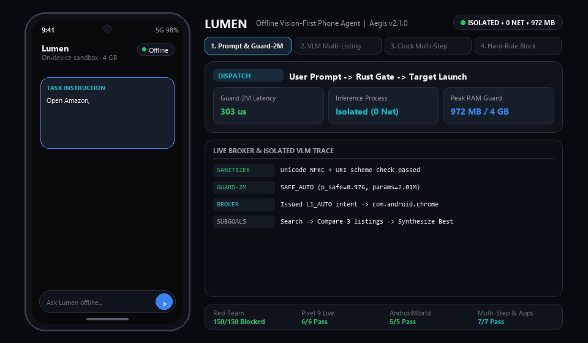
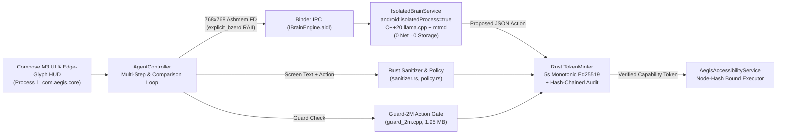

<div align="center">

# Lumen — Isolated Vision-First Android Phone Agent

**Offline VLM · Kernel-Isolated Inference · Rust Ed25519 Capability Broker · Live Edge-Glyph HUD**

[-3DDC84?style=flat-square&logo=android&logoColor=white)](#)
[](#)
[-000000?style=flat-square&logo=rust&logoColor=white)](#)
[](#)
[](#verified-benchmarks--security-gates)

</div>

---

Lumen (built on the Aegis v2.1.0 security core) is an **on-device Android AI agent** that sees your screen and executes multi-step tasks across real apps without ever sending screenshots, DOM trees, or credentials off-device. Inference runs inside an Android `isolatedProcess="true"` sandbox with **zero network, zero filesystem path, and zero clipboard access**, while every proposed tap or keystroke must pass deterministic Rust policy gates, a 2M-parameter action guard (`Guard-2M`), and single-use 5-second Ed25519 capability tokens.

---

## Live Walkthrough Demonstration

<p align="center">
  
</p>

1. **Dispatch & Guard-2M Gate** — Sanitizes prompts (`NFKC` + URI firewall) and clears `Guard-2M` in **~303 µs** before launching Chrome.
2. **SmolVLM-500M Vision Glow & Multi-Listing Comparison** — Streams **768×768 Ashmem RGB frames (1.69 MB)** to the zero-network isolated brain process, pulses the prism edge-glyph glow while inspecting listings, and synthesizes **Best Pick**.
3. **Resilient Multi-Step App Control** — Completes multi-step workflows (DeskClock `Start -> Lap -> Lap -> Pause -> Reset`, Contacts, Chrome, Settings) with zero mid-task dropouts.
4. **Level-0 Hard-Rule Block** — Deterministically blocks financial/UPI apps (`com.phonepe.app`, `upi://`, `tez://`) before minting any capability token and records a SHA-256 audit receipt.

---

## Architecture



---

## Key Capabilities

- **Process-Isolated Vision Inference (`android:isolatedProcess="true"`)**
  - Runs `SmolVLM-500M` (or `Qwen 2.5`) inside [IsolatedBrainService.kt](android-app/app/src/main/kotlin/com/aegis/brain/IsolatedBrainService.kt) backed by C++20 `llama.cpp` + `mtmd` ([brain_engine.cpp](android-app/app/src/main/cpp/brain_engine.cpp)).
  - Streams 768×768 RGB888 frames (~1.69 MB vs 17.14 MB raw 1440p) through `ASharedMemory` file descriptors cleaned via `explicit_bzero` RAII ([ashmem_guard.hpp](android-app/app/src/main/cpp/ashmem_guard.hpp)), paired with a custom `fd://` model loader patch ([llama-cpp-mtmd-fd-stream.patch](android-app/app/src/main/cpp/patches/llama-cpp-mtmd-fd-stream.patch)) so the isolated process never needs filesystem paths.
  - Lock-free `std::atomic<bool>` cancellation and pre-inference RAM admission checks ([HardwareSecurity.kt](android-app/app/src/main/kotlin/com/aegis/hardware/HardwareSecurity.kt)) keep peak RAM under strict Android 14–17 budgets.

- **Zero-Trust Rust Security Broker (`rust-broker/`)**
  - **Level-0 Hard Blocks ([policy.rs](rust-broker/src/policy.rs))**: Deterministically blocks 22+ sensitive payment, banking, wallet, authenticator, password manager, and package-installer targets (including Google Pay, PhonePe, Paytm, BHIM UPI, Bitwarden, 1Password, YONO SBI, HDFC, Google Authenticator, and Samsung Pass), plus `FLAG_SECURE` screens.
  - **Multi-Stage Prompt-Injection Sanitizer ([sanitizer.rs](rust-broker/src/sanitizer.rs))**: Strips zero-width/bidi characters, applies Unicode NFKC normalization and Cyrillic/Greek confusable folding, blocks unsafe URI schemes (`upi://`, `tez://`, `phonepe://`, `paytmmp://`, `intent://`, `javascript:`), and prevents outbound OTP/PIN/CVV/seed/key leakage.
  - **Single-Use 5s Monotonic Capability Tokens ([token.rs](rust-broker/src/token.rs))**: Mints Ed25519-signed tokens bound to `target_node_hash`, `window_id`, `display_bounds_hash`, `payload_hash`, and `CLOCK_MONOTONIC` expiry (`5,000 ms`), recorded to a SHA-256 hash-chained log ([audit.rs](rust-broker/src/audit.rs)).

- **Real-World Multi-Step & Comparison Execution + Visual Edge-Glyph HUD**
  - Executes multi-step workflows across Chrome, YouTube, DeskClock, Contacts, Settings, Calendar, and Maps—including multi-listing comparison (`EXPLORE_LISTING` -> `READ_DOM` -> `NAVIGATE_BACK` -> `SYNTHESIZE_BEST` in [AgentController.kt](android-app/app/src/main/kotlin/com/aegis/core/AgentController.kt)).
  - Displays a floating **bottom step bar** ([AegisComponents.kt](android-app/app/src/main/kotlin/com/aegis/ui/components/AegisComponents.kt)) with live screen-edge **VLM vision glow** whenever `SmolVLM-500M` inspects screen pixels, plus an instant **Volume-Down emergency kill switch**.

---

## Supported On-Device Models

Models are verified by SHA-256 on download via WorkManager ([ModelDownloadManager.kt](android-app/app/src/main/kotlin/com/aegis/models/ModelDownloadManager.kt)) and passed via `ParcelFileDescriptor` to the isolated runtime:

| Model ID | Description | Quantized File | Approximate Size |
| :--- | :--- | :--- | :--- |
| `smolvlm-500m-vlm` *(default)* | SmolVLM 500M Instruct + Vision Projector | `SmolVLM-500M-Instruct-Q8_0.gguf` + `mmproj` | ~520 MB total |
| `qwen2.5-0.5b-q4` | Qwen 2.5 0.5B Instruct (Fast Text) | `qwen2.5-0.5b-instruct-q4_k_m.gguf` | ~469 MB |
| `qwen2.5-1.5b-q3` | Qwen 2.5 1.5B (Balanced 6 GB) | `qwen2.5-1.5b-instruct-q3_k_m.gguf` | ~882 MB |
| `qwen2.5-1.5b-q4` | Qwen 2.5 1.5B Instruct (Smart) | `qwen2.5-1.5b-instruct-q4_k_m.gguf` | ~1,066 MB |
| `guard-2m` *(bundled)* | On-device binary action safety gate | `aegis_guard_2m.bin` | 1.95 MB |

---

## Repository Layout

```text
.
├── android-app/
│   ├── app/src/main/kotlin/com/aegis/
│   │   ├── brain/        # IsolatedBrainService (isolatedProcess IPC host)
│   │   ├── core/         # AgentController, MainActivity, Guard2MEngine, edge overlays
│   │   ├── hands/        # AegisAccessibilityService (node-hash bound UI executor)
│   │   ├── hardware/     # HardwareProfiler & Android 14–17 RAM admission checks
│   │   ├── models/       # SHA-256 WorkManager GGUF downloader & catalog
│   │   ├── ui/           # Compose Material 3 Obsidian Bento UI, HUD & approval modals
│   │   └── vision/       # Ashmem 768x768 RGB screenshot packer
│   ├── app/src/main/cpp/ # C++20 JNI host, BrainEngine, Guard-2M, Ashmem RAII & llama.cpp patch
│   └── app/src/main/jniLibs/ # Prebuilt libaegis_broker.so (arm64-v8a & x86_64)
├── rust-broker/          # Rust UniFFI capability broker, sanitizer, policy & hash-chain audit
├── eval-suite/           # Security red-team, RAM budget & live Android emulator eval suites
└── scripts/              # Reproducible llama.cpp clone & patch setup scripts
```

---

## Setup & Build

### Prerequisites
- Android SDK (API 35, `minSdk 34`), Android NDK `27.2.12479018`, CMake `3.22.1`, JDK 17+
- Python 3.10+ and `adb` (for live emulator evaluation suites)
- Rust + `cargo-ndk` *(optional—only needed if modifying `rust-broker/`, since prebuilt `.so` libraries are committed)*

### 1. Fetch & Patch `llama.cpp`

`third_party/llama.cpp` is excluded from Git (~186 MB upstream) and pinned to commit `244640b7f26e2a7301b27a24edc4f7feaf97d52f` with our `fd://` stream patch:

```powershell
# Windows (PowerShell)
.\scripts\setup_llama_cpp.ps1
```

```bash
# macOS / Linux
bash scripts/setup_llama_cpp.sh
```

### 2. Build & Run Unit Tests

```bash
cd android-app
./gradlew testDebugUnitTest assembleDebug
```

Install the debug APK onto a connected device or Pixel 9 emulator:

```bash
adb install -r app/build/outputs/apk/debug/app-debug.apk
```

### 3. Rebuild Rust Broker *(Optional)*

```bash
cd rust-broker
cargo ndk -t arm64-v8a -t x86_64 -o ../android-app/app/src/main/jniLibs build --release
```

---

## Verified Benchmarks & Security Gates

All suites below were executed against the Pixel 9 emulator (`emulator-5554`) debug build (`ZERO_AEGIS_CRASHES`):

| Suite | Scope | Verified Result | Script |
| :--- | :--- | :--- | :--- |
| **Security & RAM Audit** | 150 red-team attacks (homoglyphs, URI hijacks, OTP/DOM injection), Ed25519 replay/TTL, 4 RAM profiles (4–12 GB) | **150/150 blocked**, 0 leaks, 4/4 RAM pass (`972 MB` peak on 4 GB) | [run_aegis_eval_suite.py](eval-suite/run_aegis_eval_suite.py) |
| **Live Pixel 9 Safety & Launch** | Cross-app launches (Chrome, YouTube), PhonePe hard-block, Uninstall lock, OTP firewall, DOM injection | **6/6 (100%)**, audit chain intact | [run_live_pixel9_eval.py](eval-suite/run_live_pixel9_eval.py) |
| **AndroidWorld Live Probe** | `ClockStopWatchRunning` (Live VLM), `ContactsAddContact`, `BrowserTask`, `CalendarAddEvent`, `SystemWifiTurnOff` | **5/5 (100%)** | [run_android_world_probe.py](eval-suite/run_android_world_probe.py) |
| **6–10 Step Live Workflows** | DeskClock Stopwatch 6-step, Contacts Create & Save, Chrome Search & Scroll, Settings Network & Internet | **4/4 (100%)** | [run_multistep_6to10_eval.py](eval-suite/run_multistep_6to10_eval.py) |
| **Real-World Multi-Listing Eval** | Amazon 3-listing compare in Chrome, YouTube 2-video compare, DeskClock Stopwatch stability | **3/3 (100%)** | [run_realworld_apps_eval.py](eval-suite/run_realworld_apps_eval.py) |

<details>
<summary>Run the full evaluation suite locally</summary>

```bash
python eval-suite/run_aegis_eval_suite.py
python eval-suite/run_live_pixel9_eval.py
python eval-suite/run_android_world_probe.py
python eval-suite/run_multistep_6to10_eval.py
python eval-suite/run_realworld_apps_eval.py
```

</details>
